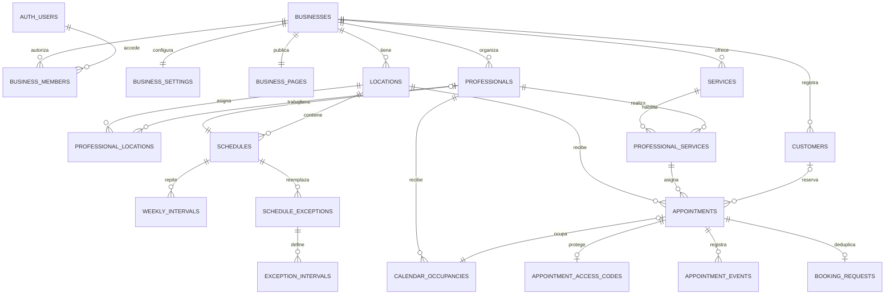

# Modelo de datos: plataforma SaaS de turnos

Estado: esquema Drizzle con 19 tablas. Las migraciones `0000`–`0003` están aplicadas al Supabase de desarrollo. La migración `0003_multi_location_support.sql` agrega soporte para varias sedes y migra los datos existentes a una sede principal.

Referencias: `PRODUCT.md`, `ARCHITECTURE.md` y `DESIGN.md`.

## 1. Alcance y decisiones

El modelo es común a todos los negocios; servicios, identidad y reglas son datos configurables. No contiene tablas específicas para una peluquería o cliente particular.

La primera entrega admite varias sedes por negocio y reservas de un servicio con un profesional. Servicios, precios, duraciones y políticas son compartidos; horarios, dirección y asignación de profesionales son propios de cada sede. Las comunicaciones y los recursos físicos se modelarán en etapas posteriores.

Decisiones principales:

- Supabase Auth administra identidades de acceso; los clientes que reservan no necesitan usuario.
- Cada entidad del negocio lleva `business_id`.
- La operación de agenda incluye `location_id`; las sedes pertenecen al negocio y profesionales se asignan explícitamente a cada sede.
- La zona horaria operativa y los datos de dirección pertenecen a la sede. `businesses.timezone` es el valor inicial sugerido al crear una sede.
- La configuración visual utiliza JSON estructurado; las relaciones operativas usan tablas y restricciones.
- La reserva guarda copias de los datos acordados para no cambiar al editar el catálogo. Decisión confirmada: aplica tanto a reservas pasadas como a reservas futuras ya confirmadas; los cambios del catálogo se aplican a nuevas reservas.
- Reservas y bloqueos comparten una tabla de ocupaciones para impedir conflictos entre ambos.
- Horarios semanales y excepciones se expresan en la zona local; las reservas guardan instantes.
- No se crean filas para cada horario libre: la disponibilidad se calcula.

## 2. Convenciones

- Esquema de aplicación: `app`, fuera de los esquemas expuestos por la Data API.
- Nombres de tablas y columnas en inglés y `snake_case`.
- Identificadores UUID generados por el servidor o PostgreSQL.
- Tablas de negocio con identidad propia: PK `id` y `UNIQUE (business_id, id)` para relaciones compuestas.
- Tablas dependientes usan claves compuestas cuando sea más natural.
- `created_at` y `updated_at`: `timestamptz`; historial append-only requiere solo `created_at`.
- `updated_at` se mantiene por trigger de base de datos en tablas mutables.
- Importes en unidades menores enteras, con moneda ISO de tres letras. Para ARS, centavos. `NULL` significa precio sin definir; cero significa gratuito.
- Estados como texto con restricciones `CHECK`, evitando valores arbitrarios y facilitando migraciones futuras.
- FK de datos históricos con `RESTRICT` salvo excepciones explicitadas. No borrar en cascada la agenda de un negocio.
- El UUID o el slug no son credenciales ni reemplazan la autorización.

## 3. Relaciones principales



El diagrama resume las relaciones del MVP. Una agenda pertenece a una sede y opcionalmente a un profesional; una ocupación pertenece a una reserva o representa un bloqueo independiente. Los servicios continúan siendo catálogo del negocio, compartido entre sedes.

## 4. Negocios, acceso y personalización

### `businesses`

| Campo | Tipo / regla |
| --- | --- |
| `id` | UUID PK |
| `name` | Texto obligatorio |
| `slug` | Texto único global, normalizado a minúsculas |
| `status` | `draft`, `active`, `suspended`, `archived` |
| `timezone` | Zona IANA, inicialmente `America/Argentina/Buenos_Aires` |
| `currency` | Código de moneda, inicialmente `ARS` |
| `category` | Etiqueta opcional de rubro, sin imponer reglas por sí misma |
| `created_at`, `updated_at` | Fechas |

El slug tiene validación de formato y lista de nombres reservados en el servidor. Cambiar zona horaria o moneda con reservas existentes requiere un procedimiento explícito, no una edición silenciosa.

La agenda del negocio se serializa con un bloqueo transaccional asesorado (`pg_advisory_xact_lock`) derivado de `businesses.id`. No se bloquea ni actualiza la fila del negocio; el runtime no necesita privilegios de escritura sobre ella. El bloqueo es por negocio, por lo que también coordina cambios entre sus sedes.

### `locations`

- `id`, `business_id`, `name`, `slug`, `address_text`, `map_url`, `contact_phone`, `arrival_instructions`, `timezone`, `is_primary`, `is_active`.
- `UNIQUE (business_id, id)` y `UNIQUE (business_id, slug)`; un índice único parcial permite una sola sede principal.
- La página de marca es del negocio; direcciones y datos de visita son de cada sede.
- Cada sede tiene zona horaria propia. `businesses.timezone` solo propone el valor inicial para nuevas sedes.
- Cada negocio nuevo se crea junto con su sede principal.
- No se borra una sede con agendas o reservas; se desactiva y se conserva el historial.

### `business_members`

- `business_id`, `user_id` (FK a `auth.users.id`), `role`, fechas.
- PK `(business_id, user_id)`.
- Rol inicial: `owner`.
- Índice único parcial por `business_id` donde `role = 'owner'`: un dueño por negocio en el MVP.
- Un usuario puede administrar varios negocios mediante distintas membresías.
- Borrar un usuario propietario requiere resolver primero la propiedad; no eliminar membresías accidentalmente por cascada.
- La creación del negocio y de su dueño ocurre en una transacción de alta. El índice asegura como máximo un dueño; el flujo de alta asegura que exista uno.

### `business_settings`

Relación 1:1; PK/FK `business_id`.

| Campo | Regla |
| --- | --- |
| `slot_interval_minutes` | Entero positivo: separación entre posibles inicios |
| `buffer_after_minutes` | Entero no negativo: margen posterior |
| `min_booking_notice_minutes` | Anticipación mínima no negativa |
| `booking_horizon_days` | Entero positivo |
| `cancellation_notice_minutes` | Anticipación mínima para cancelar |
| `allow_any_professional` | Habilita elección combinada |
| `public_booking_enabled` | Control explícito de nuevas reservas públicas |
| `version` | Entero positivo para detectar edición obsoleta |

Los valores operativos se revisan durante el alta; no se fijan 30 minutos para todos los negocios. Los límites máximos razonables se validarán al implementar formularios y API.

### `business_pages`

Relación 1:1; PK/FK `business_id`.

- `headline`, `description`, `address_text`, `map_url`, `contact_phone`, `contact_email`, `arrival_instructions`: contenido público opcional.
- `logo_storage_path`, `cover_storage_path`: rutas de objetos de Storage, no imágenes en la base de datos.
- `social_links`: JSON con claves permitidas y URLs validadas.
- `theme`: JSON con `schema_version`, paleta semántica e identificadores de fuentes permitidas.
- `visible_sections`: JSON con opciones booleanas definidas, no un constructor libre de HTML.
- `version`, `published_at`, fechas.

La fila contiene la versión publicada. El borrador inicial vive en el editor hasta guardar. Una actualización comprueba `version` e incrementa su valor, evitando sobrescribir cambios de otra pestaña sin avisar.

Los JSON se validan con Zod en el servidor y con controles básicos de tipo en PostgreSQL. Ningún JSON almacena reglas de disponibilidad o permisos. Antes de asociar un objeto Storage se verifica que pertenezca al negocio.

## 5. Catálogo y profesionales

### `services`

- `id`, `business_id`, `name`, `description` opcional.
- `duration_minutes` entero positivo.
- `price_minor` entero no negativo o `NULL`.
- `show_price` booleano.
- `is_active`, `sort_order`, fechas.

La moneda es la del negocio. El MVP no tiene modificaciones de precio o duración por profesional.

### `professionals`

- `id`, `business_id`, `display_name`, `description` opcional.
- `photo_storage_path` opcional.
- `is_active`, `sort_order`, fechas.

No requieren vínculo con `auth.users`. El orden de asignación para “cualquier profesional” es `(sort_order, id)`, de modo que los empates tengan resultado estable.

### `professional_locations`

- PK `(business_id, location_id, professional_id)`; FK compuestas a sede y profesional del mismo negocio.
- `is_active` permite retirar una asignación para nuevas reservas conservando las referencias históricas.
- Un profesional puede estar asignado a varias sedes. La asignación debe estar activa para ofrecer su agenda en esa sede.

### `professional_services`

- PK `(business_id, professional_id, service_id)`.
- FK compuestas a profesionales y servicios del mismo negocio.
- `is_active`, fechas.

Una reserva referencia esta combinación. Deshabilitarla impide nuevas reservas; se conserva la fila para mantener las referencias históricas.

## 6. Horarios y excepciones

### `schedules`

- `id`, `business_id`, `location_id`, `professional_id` nullable, fechas.
- `professional_id IS NULL`: horario general de esa sede.
- `professional_id NOT NULL`: horario individual.
- FK compuesta a la sede y, si hay profesional, a su asignación a esa sede.
- Índice único parcial `(business_id, location_id)` para la agenda general.
- Índice único parcial `(business_id, location_id, professional_id)` para agendas individuales.

La agenda es el contenedor de reglas; no almacena turnos libres. Esta tabla no habilita todavía reservas por recurso.

### `weekly_intervals`

- `id`, `business_id`, `schedule_id`.
- `weekday` entero ISO entre 1 (lunes) y 7 (domingo).
- `start_minute`, `end_minute`: minutos desde medianoche local.
- `0 <= start_minute < end_minute <= 1440`.
- FK compuesta a `schedules`.
- Exclusión de rangos enteros `[start_minute, end_minute)` para una misma agenda y día: no se superponen franjas.

Varias filas por día permiten horarios partidos. Ausencia de filas significa que no hay atención. Un horario que atraviesa medianoche se divide en dos días; no se representa con fin menor que inicio.

### `schedule_exceptions`

- `id`, `business_id`, `schedule_id`, `local_date` (`date`).
- `mode`: `closed` o `custom`.
- `reason` opcional y privado; fechas.
- `UNIQUE (business_id, schedule_id, local_date)`.
- FK compuesta a agenda.

### `exception_intervals`

- `id`, `business_id`, `exception_id`, `start_minute`, `end_minute`.
- FK compuesta a excepción y límites iguales a los semanales.
- Exclusión temporal por excepción para evitar intervalos superpuestos.

Reglas de aplicación transaccionales:

- Una excepción `closed` tiene cero intervalos; una `custom` tiene al menos uno.
- La excepción reemplaza por completo el horario semanal de ese día para esa agenda.
- Primero se resuelve el horario general de la sede; luego se intersecta con el horario individual del profesional en esa sede.
- Un cierre de sede no puede ser reabierto solo con una excepción individual.
- Guardar horarios individuales fuera de los generales produce una validación explicativa; la intersección sigue siendo la defensa al calcular disponibilidad.
- Los inicios posibles se alinean desde medianoche local en múltiplos de `slot_interval_minutes` y se filtran por intervalos disponibles. Propuesta a validar en el piloto; no se desplaza la grilla por cada reserva.

## 7. Clientes y reservas

### `customers`

- `id`, `business_id`, `display_name`, `phone_normalized`, `email` opcional, fechas.
- Teléfono normalizado en formato internacional; índice de búsqueda `(business_id, phone_normalized)` no único.
- No se comparte una ficha entre negocios.
- Un teléfono no identifica inequívocamente a una persona: familiares pueden compartirlo.

Las reservas públicas no fusionan ni actualizan automáticamente fichas existentes por coincidencia de teléfono. Pueden guardar solo sus datos de contacto y dejar `customer_id` nulo. El dueño podrá asociar una ficha al cargar o gestionar un turno; la deduplicación avanzada queda fuera del MVP.

### `appointments`

| Grupo | Campos |
| --- | --- |
| Identidad | `id`, `business_id`, `location_id` |
| Relaciones | `professional_id`, `service_id`, `customer_id` nullable |
| Estado | `status`: `confirmed`, `cancelled`, `attended`, `no_show` |
| Origen | `source`: `public`, `manual` |
| Selección | `selection_mode`: `specific`, `any` |
| Horario | `starts_at`, `ends_at` (`timestamptz`) |
| Condiciones acordadas | `duration_minutes_snapshot`, `buffer_after_minutes_snapshot`, `price_minor_snapshot`, `currency_snapshot`, `cancellation_notice_minutes_snapshot`, `timezone_snapshot` |
| Presentación histórica | `service_name_snapshot`, `professional_name_snapshot` |
| Sede acordada | `location_name_snapshot`, `location_address_snapshot` |
| Contacto del turno | `customer_name`, `customer_phone`, `customer_email` nullable |
| Cancelación | `cancelled_at`, `cancellation_reason` nullable |
| Control | `version`, `created_at`, `updated_at` |

Restricciones:

- FK `(business_id, professional_id, service_id)` a `professional_services`.
- FK compuesta a la asignación `(business_id, location_id, professional_id)` en `professional_locations`.
- La ubicación y su nombre/dirección se guardan en la reserva; la sede debe coincidir con la ocupación.
- FK de cliente compuesta cuando `customer_id` no sea nulo.
- `ends_at > starts_at` y duración igual a la copia de duración planificada.
- Duración positiva, márgenes y anticipaciones no negativos, precio nulo o no negativo.
- `cancelled_at` existe si y solo si el estado es `cancelled`.
- Siempre hay profesional asignado al persistir, incluso en modalidad `any`.

El `ends_at` representa el fin del servicio; el margen posterior solo extiende la ocupación. Copiar la política de cancelación evita cambiar las condiciones de un turno ya reservado.

Las modificaciones relevantes incrementan `version`. Cambiar precio o nombre en el catálogo no cambia reservas existentes. Una reprogramación del mismo servicio conserva precio, duración, margen y sede acordados; cambiar de servicio o sede se trata inicialmente como cancelar y crear otra reserva. Un trigger impide sobrescribir los snapshots contractuales; el nombre del profesional puede actualizarse al reasignar, conservando el anterior en el evento correspondiente.

### Transiciones

- `confirmed → cancelled`: cliente dentro del plazo, o dueño autorizado.
- `confirmed → attended / no_show`: dueño; no se registra ausencia antes del inicio del turno.
- No se marca asistencia automáticamente por el paso del tiempo.
- Correcciones administrativas se auditan y vuelven a validar restricciones.
- No se reactiva una cancelación desde la página pública.
- Las reservas pasadas no pueden cancelarse públicamente.

## 8. Ocupaciones y bloqueos

### `calendar_occupancies`

- `id`, `business_id`, `location_id`, `professional_id`.
- `appointment_id` nullable.
- `kind`: `appointment` o `block`.
- `starts_at`, `ends_at`, `is_active`.
- `reason` privado y opcional para bloqueos.
- `created_by_user_id` nullable, fechas.

Restricciones de base de datos:

- `starts_at < ends_at`.
- `kind = 'appointment'` requiere `appointment_id`; `kind = 'block'` exige que sea nulo.
- FK compuesta al profesional.
- FK `(business_id, location_id, professional_id)` a una asignación real.
- FK `(business_id, appointment_id, professional_id, location_id)` a la reserva para conservar la misma sede y profesional.
- Esta FK usa `ON UPDATE CASCADE` para reasignar profesional en la misma transacción; los triggers diferibles validan el resultado final.
- `UNIQUE (business_id, appointment_id)` conserva una ocupación por reserva; múltiples bloqueos sin reserva son válidos.
- Exclusión GiST para ocupaciones activas, incluyendo margen posterior:

```sql
EXCLUDE USING gist (
  business_id WITH =,
  professional_id WITH =,
  tstzrange(starts_at, ends_at, '[)') WITH &&
) WHERE (is_active);
```

La exclusión intencionalmente no incluye `location_id`: un profesional asignado a varias sedes no puede recibir turnos simultáneos en sedes diferentes. El MVP no calcula tiempo de traslado entre sedes; esa política queda pendiente. Requiere `btree_gist`.

### Coherencia entre reserva y ocupación

La FK y la exclusión no aseguran por sí solas que toda reserva tenga ocupación ni que sus horas coincidan. Se implementarán constraint triggers diferibles, evaluados al finalizar la transacción, sobre ambas tablas:

- Toda reserva tiene exactamente una ocupación asociada.
- El inicio coincide con el de la reserva.
- El fin coincide con el fin del servicio más el margen guardado.
- Una reserva cancelada tiene ocupación inactiva; las demás mantienen ocupación activa, incluso como registro histórico después de atenderse.

Esto permite insertar ambas filas o reprogramarlas dentro de una transacción sin dejar estados inconsistentes al confirmar. Los triggers y las restricciones tendrán pruebas de integración; no se consideran garantías implementadas hasta entonces.

Un cierre de sede se representa mediante una excepción cerrada en su agenda general, que afecta a todos sus profesionales.

## 9. Código de acceso, idempotencia e historial

### `appointment_access_codes`

- PK `(business_id, appointment_id)` y FK compuesta a reserva.
- `code_hash` único por negocio.
- `code_ciphertext`, `encryption_key_version`, `created_at`, `revoked_at` nullable.

Propuesta: 128 bits aleatorios, codificados en un formato legible que permita copiar y pegar. Se define una normalización única de separadores y mayúsculas antes de calcular SHA-256. La longitud no se reduce a un PIN numérico corto.

El texto se cifra con cifrado autenticado; nonce y etiqueta se conservan en un formato versionado junto al ciphertext. La clave de cifrado vive fuera de la base de datos. El hash sirve para buscar, el cifrado permite volver a mostrar el código en un reintento legítimo. No se registran códigos en logs ni eventos.

Las reservas públicas requieren código al confirmar. Las manuales pueden generarlo si se comparte con el cliente. Cancelar mantiene la posibilidad de mostrar “ya cancelado”; la autorización de cancelación se decide por estado y plazo, no solo por existencia del código.

### `booking_requests`

- `id`, `business_id`, `idempotency_key`, `request_hash`, `appointment_id`, `created_at`.
- `UNIQUE (business_id, idempotency_key)` y `UNIQUE (business_id, appointment_id)`.
- FK compuesta a reserva.
- Se registra solo una confirmación exitosa, dentro de la misma transacción que crea el turno.

La clave enviada por el cliente debe ser aleatoria y de alta entropía. El hash corresponde a entradas normalizadas, incluyendo servicio, modalidad/profesional solicitado, horario y contacto; no al profesional elegido internamente para modalidad `any`.

Con la misma clave y mismos datos se devuelve la misma reserva, sin crear otra. Con datos distintos se responde conflicto. Los datos de contacto no se duplican en esta tabla. El registro se conserva mientras exista la reserva para evitar duplicados por reintentos tardíos; no permite cancelar ni modificar el turno.

### `appointment_events`

- `id`, `business_id`, `appointment_id`, `event_type`, `created_at`.
- `actor_type`: `customer`, `owner`, `platform`, `system`.
- `actor_user_id` nullable; usuario de Auth cuando corresponda.
- `appointment_version`, `changes` JSON validado y acotado.
- FK compuesta a reserva.

Eventos: creación, cancelación, reprogramación, cambio de estado y corrección administrativa. `changes` registra datos operativos necesarios, como horario anterior y nuevo; no almacena secretos ni copias completas de datos personales. El rol runtime puede insertar y consultar eventos, pero no modificarlos ni borrarlos.

## 10. Transacciones y responsabilidades

Todas las operaciones de agenda siguen este orden:

1. Autorizar negocio y acción en el servidor.
2. Abrir una transacción y adquirir el bloqueo asesorado de agenda con `lockBusinessSchedule(tx, businessId)`.
3. Volver a leer configuración y datos relevantes después de obtener el bloqueo.
4. Verificar idempotencia cuando corresponda.
5. Validar horario, estado, asignación y plazo.
6. Guardar cambios, ocupaciones e historial en la misma transacción.
7. Confirmar y responder.

Las escrituras de horarios, excepciones, servicios y estado de profesionales que puedan modificar disponibilidad también toman ese bloqueo. No se usan lecturas anteriores al bloqueo para decidir una confirmación.

| Garantía | Responsable |
| --- | --- |
| Relaciones dentro del mismo negocio | FK compuestas |
| Tipos, estados y límites básicos | `NOT NULL`, `CHECK`, claves únicas |
| Ausencia de ocupaciones superpuestas | Exclusión GiST |
| Coherencia reserva–ocupación | Triggers diferibles |
| Permiso de acceso al negocio | Servidor, membresías y consultas acotadas |
| Horarios efectivos, anticipación y profesional activo | Caso de uso dentro del bloqueo transaccional |
| Excepción cerrada/custom y sus intervalos | Caso de uso transaccional |
| Reintentos de confirmación | Clave única y hash de solicitud |
| No perder la reserva al fallar reprogramación | Rollback transaccional |

Cambiar reglas que afecten reservas existentes requiere mostrar el impacto y resolverlo según el flujo del producto. No se cancelan ni desplazan automáticamente.

## 11. Índices iniciales

Además de PK, claves únicas e índices GiST:

- `business_members (user_id, business_id)` para negocios del dueño.
- `services (business_id, is_active, sort_order)`.
- `professionals (business_id, is_active, sort_order)`.
- `professional_services (business_id, service_id, is_active, professional_id)`.
- `schedule_exceptions (business_id, schedule_id, local_date)` mediante su clave única.
- `customers (business_id, phone_normalized)`.
- `appointments (business_id, location_id, starts_at)` para agenda por sede.
- `appointments (business_id, professional_id, starts_at)` para agenda individual.
- `appointments (business_id, customer_id, starts_at)` para historial asociado.
- `appointment_events (business_id, appointment_id, created_at, id)`.
- Índices de las columnas FK que no estén cubiertas por claves o índices anteriores, según consultas de actualización y borrado.

Las consultas de ocupación deben usar operaciones de solapamiento compatibles con el índice de rangos. No se almacenan totales del dashboard inicialmente: se calculan con filtros por negocio y período local convertido a instantes.

## 12. Acceso, conservación y bajas

- El rol runtime tiene permisos explícitos en `app`; no es dueño de tablas ni rol de migraciones.
- Sin permisos de acceso directo de `anon` y `authenticated` a estas tablas por la Data API.
- Drizzle no hereda automáticamente la identidad de Supabase Auth. Todas las consultas privadas se autorizan y acotan por negocio.
- Los permisos de Storage se configuran por separado.
- Desactivar servicios, profesionales o negocios preserva referencias históricas.
- No se incluyen borrados definitivos de negocios desde el panel del MVP.
- Eliminar o anonimizar datos personales debe contemplar clientes, contactos copiados en reservas, códigos y futuras comunicaciones; no basta con borrar una ficha de cliente.
- El plazo de conservación y el procedimiento de anonimización se definirán antes del lanzamiento comercial.
- Para `suspended`, la propuesta es impedir nuevas reservas públicas y permitir gestionar cancelaciones existentes; requiere confirmación de producto antes de implementar ese flujo.

## 13. Evolución prevista

### Avisos y recordatorios — etapa 2

Agregar cuando se implemente el módulo:

- `notification_preferences`: canales, eventos y anticipaciones por negocio.
- `notification_templates`: textos permitidos, tipo de evento, canal y versión.
- `outbox_events`: eventos persistidos con la transacción de reserva, versión y estado de procesamiento.
- `notification_jobs`: reserva, versión, canal, momento programado, deduplication key, estado, intentos y bloqueo de ejecución.
- `notification_attempts`: resultado e identificador del proveedor por intento.

La deduplicación debe distinguir evento, reserva, versión, canal y anticipación. Al cancelar o reprogramar se invalidan tareas pendientes; antes de enviar se verifica la versión vigente. El historial de reserva no sustituye una outbox de entrega durable.

### Recursos y canchas — etapa 3

- Incorporar `resources` con tipo, nombre y estado por negocio.
- Introducir una entidad reservable común o extender agendas con propietario explícito profesional/recurso y una restricción de exactamente uno.
- Migrar ocupaciones para referenciar esa agenda reservable.
- Para servicios con profesional y recurso, crear varias ocupaciones ligadas a una reserva en una única transacción.
- Reemplazar entonces la unicidad de una ocupación por reserva y adaptar los triggers de coherencia.
- Para reserva exclusiva de un recurso, la reserva deja de exigir profesional; no se crean profesionales ficticios.

Esta extensión requiere migración y pruebas propias. La primera entrega no afirma soportar capacidad física compartida.

### Otras ampliaciones

Sedes múltiples se incorporan en el MVP mediante `locations`; formularios adicionales mediante definiciones versionadas y respuestas; precios por franja mediante reglas específicas. No se crean tablas vacías para estas funciones.

## 14. Plan de migraciones y verificación

Orden de implementación propuesto:

1. Esquema `app`, extensión `btree_gist` y roles/permisos necesarios.
2. Negocios, sedes, membresías, configuración y página pública.
3. Catálogo, profesionales, asignaciones a sedes y habilitaciones.
4. Agendas por sede, intervalos y excepciones.
5. Clientes, reservas por sede, ocupaciones, códigos, solicitudes idempotentes y eventos.
6. Restricciones especiales, triggers e índices.

Las migraciones se ejecutan en un entorno de desarrollo/prueba antes de aplicarse a producción. Los seeds utilizan negocios ficticios y no cambian el esquema administrado de Supabase Auth.

Casos de integración imprescindibles:

- Rechazo de una relación cruzada entre dos negocios.
- Rechazo de reservar a un profesional en una sede a la que no está asignado.
- Aceptación del mismo servicio compartido en sedes distintas.
- Rechazo de turnos simultáneos del mismo profesional en sedes distintas.
- Rechazo de dos reservas o de una reserva y un bloqueo superpuestos.
- Aceptación de intervalos adyacentes y de profesionales diferentes a la misma hora.
- Ocupación que incluye margen posterior y respeta el cierre.
- Rollback de reprogramación si el nuevo horario está ocupado.
- Rechazo al finalizar transacción de reservas sin ocupación o con ocupación incoherente.
- Cancelación que libera disponibilidad sin borrar historial.
- Confirmaciones concurrentes y reintentos idempotentes.
- Cambio concurrente de horario frente a confirmación de reserva.
- Excepción cerrada y excepción personalizada sobre horario partido.
- Conservación de precio, duración y política al editar el catálogo.
- Validación de permisos del rol runtime y falta de acceso público directo.

## 15. Decisiones que requieren validación de producto

- Valores iniciales de anticipación, horizonte y cancelación para el alta.
- Alineación de inicios desde medianoche local propuesta en este documento.
- Comportamiento comercial de una suspensión y conservación de datos.
- Canal y alcance inicial de recordatorios.

Estas decisiones no bloquean las tablas existentes; los valores operativos serán configurables. Los siguientes pasos son aplicar las migraciones al entorno de desarrollo y construir los casos de uso autorizados y el motor de disponibilidad.
